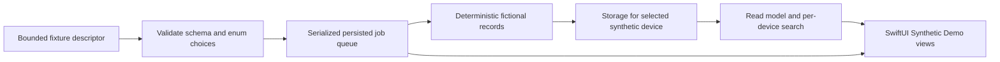

# DeviceBridge specification

Version 0.1 · 6 October 2026 · Synthetic prototype

DeviceBridge is an independent, local macOS viewer for calls and messages from multiple consenting, trusted devices. The first milestone demonstrates its interface, per-device storage, import boundary, and job lifecycle using fictional fixtures only. It does not connect to a device or read a real backup.

This document specifies the prototype contract and future design gates. The [README](../README.md) records launch instructions, and the [verification log](verification.md) records build/test results; the [roadmap](roadmap.md) separates prototype acceptance from unimplemented device support.

## Scope and product contract

| Current milestone | Future, separately approved work |
| --- | --- |
| Native Swift/SwiftUI macOS interface and arm64 command-line harness | Consenting adults' trusted-device enrollment |
| Clearly marked **Synthetic Demo** device list, records, and job status | USB pairing and local backup acquisition |
| Deterministic fictional calls/messages, local per-device search | Local parsing of supported backup versions |
| Bounded fixture import, isolated storage, one job at a time | Wi-Fi transport after verified USB trust |
| Visible failure, interruption, retry, and restart recovery | Encryption, Keychain, retention, revocation, and distribution hardening |

No current component may access a real device, pairing records, credentials, private communications, child data, existing system backups, cloud services, or accounts. No telemetry, networking, Qustodio private APIs, or real backup import is included. The project must neither modify Qustodio nor reuse its binaries, code, or assets. Public documentation informs feasibility only.

Every runnable component delivered by this project must be arm64. Use the installed supported Apple toolchain, Foundation, Swift concurrency, and SwiftUI; no Electron, Intel helper, Rosetta requirement, or dependency installation is needed for the prototype. Build and test with at most two SwiftPM jobs. A native worker alone would not satisfy this requirement: inspect both the app and harness binaries, and all future embedded helpers.

## User experience

The application displays a persistent **Synthetic Demo** notice. Device names and record contents must be unmistakably fictional; no fixture should look like an imported person's private history. Selecting a device limits calls, messages, searches, and the displayed record totals to that device. Empty results must differ from an import failure.

The sidebar shows each simulated device and its status. The detail area shows local call and message history, search, and the most recent import outcome. Calls include a fictional participant, timestamp, direction, and duration; messages include a fictional participant, timestamp, direction, and canned text. Records are read-only.

Users can enqueue a demo job, inspect its state, interrupt active work, and explicitly retry an interrupted or failed job. Failure and offline scenarios are simulated and labeled. The interface reports what happened, which device was affected, and the available next action without suggesting that a physical device was contacted. Status must be written in text rather than conveyed by color alone.

## Data flow and boundaries

The fixture descriptor chooses known scenarios and fixed synthetic device identities. Imported descriptors cannot provide arbitrary message text, participant names, phone numbers, filesystem destinations, executable commands, URLs, or device identifiers. Unknown enum values, unsupported schema versions, malformed data, oversized inputs, and values outside documented limits must be rejected before storage changes. The fixture catalog generates the actual record text and stable record identities. Reimporting the same fixture must not duplicate the history.

The storage abstraction accepts an explicit device identifier for every history operation. Device records live in separate device namespaces and are validated against their owning device on load and save. Search runs only over the selected device's records. The shared queue may contain jobs for several devices but must never choose a destination from unchecked input. Simulated connection state is UI data, not evidence of physical connectivity.

Prototype persistence is local, readable demo data. It is not a secure vault. The designated demo directory contains device snapshots and queue state; generated data and build outputs stay out of Git. The app and harness should use separate storage roots for independent runs, and tests should use temporary directories. Concurrent processes writing one store are not a supported usage unless explicitly tested.

## Queue and interruption contract

One worker processes one job at a time across all devices. A job has a stable identity, target device, scenario, attempt information, progress, and an observable state. Queue mutation and record import run through the core abstraction rather than directly from view code.

| State | Meaning | Next action |
| --- | --- | --- |
| Queued | Accepted and saved; waiting for the worker | Run while the host and process are available |
| Running | Worker owns the job | Complete, fail, or interrupt |
| Completed | Record save completed and success was saved | View local history |
| Failed | A simulated or actual local operation failed | Show reason; explicit retry |
| Interrupted | Work stopped before confirmed completion, including recovery of a saved running job | Explicit retry |

Transitions must be persisted before the interface reports them as saved. Recovery must convert a persisted running job to interrupted and report it; it must not silently mark the job successful or automatically retry it. Retry reuses the same deterministic fixture and preserves attempt visibility. A failure for one device must not corrupt another device's data. A write error must remain visible rather than be converted to an empty device list or successful job.

Queue state and device snapshots may be atomically replaced as individual files. That reduces partially written files but is **not a filesystem durability guarantee**, a transaction across files, or proof that all updates survive sudden power loss. A crash between record save and success-state save can leave an interrupted job with its records already present; idempotent import makes an explicit retry safe. Corrupt-state handling must preserve the original data and report the problem instead of silently resetting it.

Mock work requires an awake, running host and application or harness process. The prototype has no launch agent, scheduled background service, wake mechanism, or promise to progress during power loss or sleep. After an outage, reopen it when the host is available, inspect the recovered state, and retry interrupted work explicitly. Queued work and interrupted work are distinct.

## Security, privacy, and consent

The current defense is a narrow synthetic input boundary. Synthetic labels and enum validation do not verify a person's consent or protect confidential data. Keychain storage, encryption at rest, authenticated data, secure deletion, consent verification, app sandboxing, and notarization are not implemented. The local build uses an ad-hoc code signature only; it is not a Developer ID signature, notarization, or an audited security control.

Before real data is introduced, the product needs these reviewed behaviors:

1. Explain locally which data categories will be copied, where they will be stored, and retention before enrolling each device. Require explicit consent from the participating device owner and an on-device trust action; do not treat possession of an unlocked device as sufficient consent.
2. Record the approved scope and allow cancellation before every first acquisition. Keep every device's credentials, source backup, normalized history, queue, and search index separate. Never put passwords or message content in job errors or logs.
3. Design and verify encrypted storage, a Keychain-backed secret provider, access controls, key rotation, and recovery. Do not collect Apple ID credentials or device passcodes; any future backup-password flow must be separately designed and tested.
4. Offer visible pause, revoke, and local-data deletion controls. Revocation must stop queued and active acquisition, remove app-held credentials/pairing material where appropriate, and distinguish retained data from deleted data. Explain any separate device/OS trust-reset step accurately.
5. Bound parser resources and reject path traversal, symlink escape, malformed manifests, and cross-device records. Test failure, interrupted cleanup, and deletion before handling private backups. Document limits of deletion on modern storage.

Real child data, covert monitoring, cloud accounts, account creation, and unrelated device-management features remain outside this design.

## Future transport and availability

The proposed sequence is manual USB enrollment and a successful local acquisition first, then explicitly enabled local Wi-Fi acquisition for the same trusted device. A future adapter may use a pinned, reviewed upstream `libimobiledevice` build. Upstream describes native-protocol communication, backup utilities, and Wi-Fi connections for devices with Wi-Fi sync enabled; it is an independent project, not an Apple SDK. This supports exploration, not a compatibility guarantee. [Upstream README](https://github.com/libimobiledevice/libimobiledevice#readme) (checked 6 October 2026).

Dependency approval must cover each pinned source file and transitive dependency, linkage/distribution choices, notices, source or relinking obligations where applicable, vulnerabilities, and arm64 builds. The upstream README describes LGPL 2.1, the `idevicebackup2` source header states LGPL 2.1 or later, and the repository contains both GPL and LGPL license texts. Do not infer every component's terms from a repository badge. Nothing from upstream is embedded in this milestone. [README license section](https://github.com/libimobiledevice/libimobiledevice#license), [utility header](https://github.com/libimobiledevice/libimobiledevice/blob/master/tools/idevicebackup2.c), [COPYING](https://github.com/libimobiledevice/libimobiledevice/blob/master/COPYING), [COPYING.LESSER](https://github.com/libimobiledevice/libimobiledevice/blob/master/COPYING.LESSER) (checked 6 October 2026).

Qustodio's public setup describes an initial USB connection with on-device Trust, later updates on the same Wi-Fi network, hourly updates, and the requirement that its desktop app stay running. These are observations about that product, not functionality implemented or promised by DeviceBridge. Its documentation also references the local backup encryption password. [Qustodio setup guide](https://help.qustodio.com/hc/en-us/articles/4986837688465-How-do-I-set-up-calls-messages-monitoring-for-iOS-devices) (checked 6 October 2026).

Apple lists call history among the information encrypted local backups can include beyond unencrypted backups. A backup password is needed to use the encrypted backup; encryption is not enabled by default. This does not guarantee that a particular call or an entire history will be available. [Apple: encrypted backups](https://support.apple.com/en-us/108353) (published 21 September 2026; checked 6 October 2026).

Apple states that computer backups exclude data already synced and stored in iCloud, including iMessages, SMS, and MMS; iCloud backups also exclude messages when Messages in iCloud is enabled. DeviceBridge must report source and acquisition time, unavailable categories, and parse errors rather than claim complete history or interpret missing records as proof that no activity occurred. It will not fetch the missing data from iCloud. [Apple: backup methods](https://support.apple.com/en-us/108771) (published 25 February 2025; checked 6 October 2026).

The future availability model must account for OS and backup-schema changes, device lock/trust state, transport reachability, host sleep, storage capacity, encryption, and partial acquisition. Tests must establish the supported matrix; neither upstream support nor another product's behavior establishes DeviceBridge support.

Apple says general Rosetta availability extends through macOS 27, with functionality restricted to certain older games starting in macOS 28. This reinforces the requirement that the app and every future helper run natively on Apple silicon. [Apple: Intel-based apps](https://support.apple.com/en-us/102527) (published 21 September 2026; checked 6 October 2026).

## Acceptance evidence

Acceptance requires a successful bounded arm64 build; binary architecture inspection; automated coverage of fixture rejection, per-device isolation, queue serialization, retry, restart recovery, and deterministic reimport; and a launch check of the native interface. The harness must make success, failure, and interruption reproducible without physical hardware, network access, private files, or secrets. Record exact commands and observed outcomes in the verification log, including any visual checks that could not be performed.

The prototype establishes local software behavior only. Passing fixture tests does not establish real-device compatibility, complete backup coverage, security certification, consent verification, or power-loss durability.
